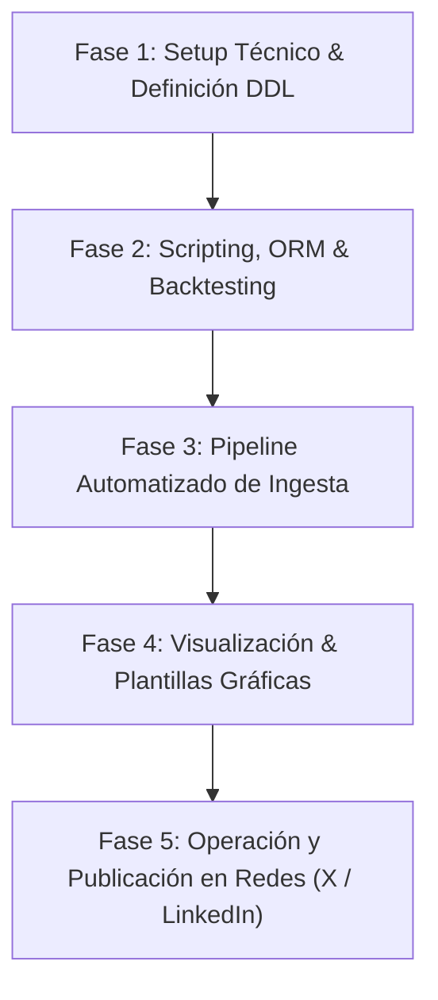

# DOCUMENTO MAESTRO DEL PROYECTO: ANALÍTICA DE ENTRENADORES (AEP)
**Versión:** 1.0 (Actualizada con Auditoría y Propuestas de Mejora v1)  
**Estado:** Fase 1 — Setup Técnico, Arquitectura & Refinamiento Metodológico  
**Ámbito:** Liga Profesional de Fútbol Argentino & Copas Conmebol  

---

## 1. RESUMEN EJECUTIVO Y PROPÓSITO

### 1.1. Visión del Proyecto
El proyecto **AEP (Analítica de Entrenadores & Performance)** nace para llenar un vacío analítico en el fútbol argentino y regional: mientras que el análisis de jugadores y métricas individuales (xG, xA, mapas de pases) está ampliamente cubierto, la evaluación objetiva del rendimiento de los **Directores Técnicos (DTs)** suele limitarse a opiniones subjetivas o a la tabla de posiciones general del equipo.

Este proyecto implementa un sistema cuantitativo basado en el **sistema de puntuación ELO**, adaptado específicamente a la figura del entrenador de fútbol. El objetivo es aislar la incidencia de la pizarra, la dificultad del contexto competitivo, la localía y la toma de decisiones durante el desarrollo de los encuentros.

### 1.2. Propuesta de Valor y Marca Personal
- **En X (Twitter):** Consumo rápido, atractivo e interactivo con el aficionado mediante infografías y rankings periódicos:
  - *"Power Ranking de la Fecha"*: Mayores subidas y caídas semanales de ELO en el fútbol argentino.
  - *"Duelo de Pizarras"*: Infografías cara a cara previas a los clásicos o partidos definitorios.
- **En LinkedIn:** Exposición de casos de estudio técnicos dirigidos a clubes, consultoras deportivas e industria de Data Science / Data Engineering, mostrando el flujo integral de datos: modelado relacional en PostgreSQL, pipelines en Python, validación matemática y visualización avanzada.

---

## 2. AUDITORÍA DEL CÓDIGO Y EVALUACIÓN DE DECISIONES TÉCNICAS (v0)

Tras analizar los archivos base (`DT.py`, `Proyecto DT.py`) y la documentación original, se identifican decisiones muy acertadas junto a áreas concretas de mejora:

### 2.1. Aciertos Destacados de la Implementación Inicial
1. **Separación de Entornos y Seguridad:** Uso estricto de `python-dotenv` y lectura de credenciales de conexión vía variables de entorno (`.env`), evitando credenciales quemadas en el repositorio.
2. **Atomicidad Transaccional:** La utilización del context manager `with engine.begin() as conn:` garantiza que las actualizaciones de ELO de ambos DTs y el registro histórico en `partidos_dt` se ejecuten dentro de una transacción ACID. Si falla cualquier consulta, se efectúa un rollback automático.
3. **Simetría Matemática Conservativa (Suma Cero):** Al formular la expectativa del DT visitante como complementaria con la localía virtual, el intercambio de puntos es de suma cero ($\Delta_{local} = -\Delta_{visita}$), manteniendo estable la masa total de puntos del sistema.
4. **Adopción de Logging:** Registro formal mediante la librería estándar `logging` con formato estructurado de fecha y niveles en lugar de declaraciones `print()`.

### 2.2. Inconsistencias y Oportunidades de Mejora Detectadas

| Componente | Estado Actual (v0) | Diagnóstico / Riesgo | Propuesta de Mejora (v1) |
| :--- | :--- | :--- | :--- |
| **Duplicación de Código** | Existen `DT.py` y `Proyecto DT.py` con discrepancias menores en nombres de parámetros (`marcador_pre_cambios_local` vs `marcador_pre_local`). | Riesgo de desincronización y deuda técnica. | Unificar la lógica en un único módulo centralizado (`DT.py`). |
| **Consultas SQL** | Se utilizan strings SQL crudos con `text("...")`. | Incumple la buena práctica de arquitectura y reglas globales cuando hay un ORM disponible. Pérdida de autocompletado y tipado estricto. | Migrar a **SQLAlchemy Declarative ORM** o Core con modelos formales de datos. |
| **Campos de Club** | `partidos_dt` define `club_local_id` y `club_visita_id`, pero la función no los recibe ni los inserta (quedan en `NULL`). | Impide filtrar el ELO histórico de un DT al cambiar de equipo o medir el impacto según la jerarquía del club. | Incorporar `club_local_id` y `club_visita_id` como parámetros obligatorios. |
| **Idempotencia** | La tabla `partidos_dt` no posee una restricción única por partido (`UNIQUE(fecha, competencia_id, dt_local_id, dt_visita_id)`). | Si un script de ingesta se ejecuta dos veces por error, duplica los registros y altera irreversiblemente el ELO de los DTs. | Agregar constraint `UNIQUE` y verificación previa o cláusula `ON CONFLICT`. |
| **Margen de Victoria (MOV)** | Un triunfo 1-0 otorga el mismo puntaje que una goleada 5-0. | Subestima actuaciones superlativas o caídas catastróficas. | Implementar un multiplicador por diferencia de goles amortiguado (usado en el ELO FIFA y FiveThirtyEight). |
| **Indexación en PostgreSQL** | La tabla `partidos_dt` no posee índices en claves foráneas ni fechas. | Consultas de historial y rachas (`WHERE dt_local_id = X OR dt_visita_id = X`) harán Table Scan a medida que crezca la base. | Crear índices compuestos en `(dt_local_id, fecha)` y `(dt_visita_id, fecha)`. |

---

## 3. MODELO MATEMÁTICO REFINADO (v1)

### 3.1. Fórmula Central del Sistema ELO
La variación de puntos de un DT tras un encuentro se define por:

$$\Delta ELO = K \cdot C \cdot G \cdot (R - E)$$

Donde:
- **$K$ (Factor de Volatilidad):** Define el impacto según la trascendencia del partido.
  - $K = 20$: Partido regular de liga / fase de grupos.
  - $K = 30$: Clásicos históricos o llaves de eliminación directa (Octavos / Cuartos / Semifinales).
  - $K = 40$: Finales de campeonato o partidos por el título.
- **$C$ (Coeficiente de Competencia):** Ponderador de jerarquía del certamen.
  - Nivel S ($1.30$): Copa Libertadores, Mundial de Clubes / Intercontinental.
  - Nivel A ($1.00$): Liga Profesional de Fútbol Argentino, Copa Sudamericana.
  - Nivel B ($0.80$): Copa Argentina, Copa de la Liga.
  - Nivel C ($0.60$): Torneos de ascenso (Primera Nacional) / Copas de pretemporada oficiales.
- **$G$ (Multiplicador de Margen de Victoria - MOV):** *[Nuevo en v1]*  
  Ajusta el impacto según la contundencia del resultado:
  $$G = \begin{cases} 1.0 & \text{si hay empate o diferencia de 1 gol} \\ 1.5 & \text{si la diferencia es de 2 goles} \\ \frac{1.75 + |\Delta \text{goles}|}{3} & \text{si la diferencia es de 3 o más goles} \end{cases}$$
- **$R$ (Resultado Real):**
  - Victoria: $1.0$
  - Empate: $0.5$
  - Derrota: $0.0$
- **$E$ (Expectativa de Rendimiento):**
  Calculada con la función logística tradicional sobre una escala de 400 puntos, incorporando la **ventaja por localía** ($+30$ puntos al local):
  $$E_{local} = \frac{1}{1 + 10^{\frac{(ELO_{visita} - (ELO_{local} + 30))}{400}}}$$
  $$E_{visita} = 1.0 - E_{local}$$

### 3.2. Puntuación Inicial de Referencia ($P_0$)
- Todo DT ingresa al sistema con una base teórica de **$1000.00$ puntos**.
- Durante la **Fase 2 de Backtesting**, se procesará el historial previo (últimas 2 o 3 temporadas) para que los entrenadores consagrados arranquen el torneo actual con un ELO calibrado y representativo.

### 3.3. KPIs Secundarios del Entrenador
1. **Efectividad del Banco de Suplentes (`impacto_banco`):**
   - Categorizado en:
     - `+1`: El equipo mejoró el marcador tras los primeros cambios (ej. de empatar a ganar, o de perder a empatar/ganar).
     - `0`: El resultado final mantuvo la misma diferencia que había al momento de los cambios.
     - `-1`: El equipo empeoró tras las modificaciones.
2. **Índice de Rescate / Corta-Rachas:**
   - Mide la cantidad de partidos que le insume a un nuevo DT cortar una racha negativa heredada ($\ge 4$ fechas sin ganar), y el porcentaje de puntos obtenidos en los 5 partidos posteriores a dicho quiebre.

---

## 4. ESQUEMA DE BASE DE DATOS OPTIMIZADO (POSTGRESQL DDL v1)

```sql
-- Base de Datos: aep_football_analytics
-- Versión del Esquema: 1.1

CREATE TABLE IF NOT EXISTS entrenadores (
    dt_id SERIAL PRIMARY KEY,
    nombre VARCHAR(100) NOT NULL,
    apellido VARCHAR(100) NOT NULL,
    nacionalidad VARCHAR(50),
    fecha_nacimiento DATE,
    elo_actual NUMERIC(6, 2) NOT NULL DEFAULT 1000.00,
    creado_en TIMESTAMP WITH TIME ZONE DEFAULT CURRENT_TIMESTAMP
);

CREATE TABLE IF NOT EXISTS competencias (
    competencia_id SERIAL PRIMARY KEY,
    nombre VARCHAR(100) NOT NULL,
    nivel VARCHAR(10) NOT NULL CHECK (nivel IN ('S', 'A', 'B', 'C')),
    coeficiente NUMERIC(3, 2) NOT NULL
);

CREATE TABLE IF NOT EXISTS clubes (
    club_id SERIAL PRIMARY KEY,
    nombre VARCHAR(100) NOT NULL,
    pais VARCHAR(50) DEFAULT 'Argentina'
);

CREATE TABLE IF NOT EXISTS partidos_dt (
    partido_id SERIAL PRIMARY KEY,
    fecha DATE NOT NULL,
    competencia_id INT NOT NULL REFERENCES competencias(competencia_id),
    
    -- Entrenador y Club Local
    dt_local_id INT NOT NULL REFERENCES entrenadores(dt_id),
    club_local_id INT NOT NULL REFERENCES clubes(club_id),
    elo_local_previo NUMERIC(6, 2) NOT NULL,
    elo_local_nuevo NUMERIC(6, 2) NOT NULL,
    delta_elo_local NUMERIC(6, 2) GENERATED ALWAYS AS (elo_local_nuevo - elo_local_previo) STORED,
    goles_local INT NOT NULL CHECK (goles_local >= 0),
    
    -- Entrenador y Club Visitante
    dt_visita_id INT NOT NULL REFERENCES entrenadores(dt_id),
    club_visita_id INT NOT NULL REFERENCES clubes(club_id),
    elo_visita_previo NUMERIC(6, 2) NOT NULL,
    elo_visita_nuevo NUMERIC(6, 2) NOT NULL,
    delta_elo_visita NUMERIC(6, 2) GENERATED ALWAYS AS (elo_visita_nuevo - elo_visita_previo) STORED,
    goles_visita INT NOT NULL CHECK (goles_visita >= 0),
    
    -- Métricas de Lectura de Juego
    marcador_pre_cambios_local VARCHAR(10),
    marcador_pre_cambios_visita VARCHAR(10),
    impacto_banco_local INT CHECK (impacto_banco_local IN (-1, 0, 1)),
    impacto_banco_visita INT CHECK (impacto_banco_visita IN (-1, 0, 1)),

    -- Factor K utilizado
    factor_k INT NOT NULL DEFAULT 20 CHECK (factor_k IN (20, 30, 40)),

    -- Control de Idempotencia: Evita duplicar el mismo partido entre dos DTs en la misma fecha
    CONSTRAINT uq_partido_fecha_dts UNIQUE (fecha, competencia_id, dt_local_id, dt_visita_id)
);

-- Índices para optimización de consultas de rendimiento histórico y Power Rankings
CREATE INDEX IF NOT EXISTS idx_partidos_dt_local ON partidos_dt(dt_local_id, fecha DESC);
CREATE INDEX IF NOT EXISTS idx_partidos_dt_visita ON partidos_dt(dt_visita_id, fecha DESC);
CREATE INDEX IF NOT EXISTS idx_partidos_fecha ON partidos_dt(fecha DESC);
CREATE INDEX IF NOT EXISTS idx_entrenadores_elo ON entrenadores(elo_actual DESC);
```

---

## 5. DISEÑO DE ARQUITECTURA EN PYTHON CON SQLALCHEMY ORM (v1)

En conformidad con las directrices globales de ingeniería (sustituir SQL en texto por ORM tipado), se presenta el diseño recomendado de entidades y servicio:

```python
# models.py
from datetime import date, datetime
from typing import Optional
from sqlalchemy import CheckConstraint, Date, DateTime, ForeignKey, Integer, Numeric, String, UniqueConstraint
from sqlalchemy.orm import DeclarativeBase, Mapped, mapped_column, relationship


class Base(DeclarativeBase):
    pass


class Coach(Base):
    __tablename__ = "entrenadores"

    dt_id: Mapped[int] = mapped_column(Integer, primary_key=True, autoincrement=True)
    nombre: Mapped[str] = mapped_column(String(100), nullable=False)
    apellido: Mapped[str] = mapped_column(String(100), nullable=False)
    nacionalidad: Mapped[Optional[str]] = mapped_column(String(50))
    fecha_nacimiento: Mapped[Optional[date]] = mapped_column(Date)
    elo_actual: Mapped[float] = mapped_column(Numeric(6, 2), default=1000.00, nullable=False)
    creado_en: Mapped[datetime] = mapped_column(DateTime, default=datetime.utcnow)


class Competition(Base):
    __tablename__ = "competencias"

    competencia_id: Mapped[int] = mapped_column(Integer, primary_key=True, autoincrement=True)
    nombre: Mapped[str] = mapped_column(String(100), nullable=False)
    nivel: Mapped[str] = mapped_column(String(10), nullable=False)
    coeficiente: Mapped[float] = mapped_column(Numeric(3, 2), nullable=False)

    __table_args__ = (
        CheckConstraint("nivel IN ('S', 'A', 'B', 'C')", name="check_nivel_competencia"),
    )


class Club(Base):
    __tablename__ = "clubes"

    club_id: Mapped[int] = mapped_column(Integer, primary_key=True, autoincrement=True)
    nombre: Mapped[str] = mapped_column(String(100), nullable=False)
    pais: Mapped[Optional[str]] = mapped_column(String(50), default="Argentina")


class MatchCoach(Base):
    __tablename__ = "partidos_dt"

    partido_id: Mapped[int] = mapped_column(Integer, primary_key=True, autoincrement=True)
    fecha: Mapped[date] = mapped_column(Date, nullable=False)
    competencia_id: Mapped[int] = mapped_column(ForeignKey("competencias.competencia_id"), nullable=False)

    dt_local_id: Mapped[int] = mapped_column(ForeignKey("entrenadores.dt_id"), nullable=False)
    club_local_id: Mapped[int] = mapped_column(ForeignKey("clubes.club_id"), nullable=False)
    elo_local_previo: Mapped[float] = mapped_column(Numeric(6, 2), nullable=False)
    elo_local_nuevo: Mapped[float] = mapped_column(Numeric(6, 2), nullable=False)
    goles_local: Mapped[int] = mapped_column(Integer, nullable=False)

    dt_visita_id: Mapped[int] = mapped_column(ForeignKey("entrenadores.dt_id"), nullable=False)
    club_visita_id: Mapped[int] = mapped_column(ForeignKey("clubes.club_id"), nullable=False)
    elo_visita_previo: Mapped[float] = mapped_column(Numeric(6, 2), nullable=False)
    elo_visita_nuevo: Mapped[float] = mapped_column(Numeric(6, 2), nullable=False)
    goles_visita: Mapped[int] = mapped_column(Integer, nullable=False)

    marcador_pre_cambios_local: Mapped[Optional[str]] = mapped_column(String(10))
    marcador_pre_cambios_visita: Mapped[Optional[str]] = mapped_column(String(10))
    impacto_banco_local: Mapped[int] = mapped_column(Integer, default=0)
    impacto_banco_visita: Mapped[int] = mapped_column(Integer, default=0)
    factor_k: Mapped[int] = mapped_column(Integer, default=20)

    __table_args__ = (
        UniqueConstraint("fecha", "competencia_id", "dt_local_id", "dt_visita_id", name="uq_partido_fecha_dts"),
        CheckConstraint("factor_k IN (20, 30, 40)", name="check_factor_k"),
        CheckConstraint("impacto_banco_local IN (-1, 0, 1)", name="check_impacto_local"),
        CheckConstraint("impacto_banco_visita IN (-1, 0, 1)", name="check_impacto_visita"),
    )
```

---

## 6. HOJA DE RUTA DETALLADA (ROADMAP DEL PROYECTO)



### Detalle de Fases
- **Fase 1: Setup Técnico & Definiciones (Completada)**
  - [x] Definición formal del modelo ELO y factores multiplicadores.
  - [x] Esquema DDL en PostgreSQL con constraints e índices.
  - [x] Auditoría técnica de los scripts preliminares.
- **Fase 2: Scripting & Backtesting (Siguiente Paso)**
  - [ ] Implementar el servicio con SQLAlchemy ORM eliminando strings SQL crudos.
  - [ ] Incorporar parámetros `club_local_id` y `club_visita_id`.
  - [ ] Cargar competencias base (Liga Profesional, Copa Libertadores, Copa Argentina, etc.).
  - [ ] Ejecutar backtesting histórico de los DTs actuales (mínimo últimas 2 temporadas) para no iniciar en una base homogénea de 1000 puntos.
- **Fase 3: Ingesta Continua**
  - [ ] Conexión con API-Football para extracción de eventos post-partido (goles y minutos de sustituciones).
  - [ ] Automatización de cálculo de `marcador_pre_cambios` e `impacto_banco`.
- **Fase 4: Visualización & Branding**
  - [ ] Scripts en `matplotlib` / `mplsoccer` para generar automáticamente infografías limpias y listas para publicar.
  - [ ] Diseño de layout para el *"Power Ranking"* semanal y el *"Duelo de Pizarras"*.
- **Fase 5: Difusión y Posicionamiento**
  - [ ] Lanzamiento en X con hilos de debate basados en datos.
  - [ ] Casos de estudio en LinkedIn sobre ingeniería de datos deportivos.
