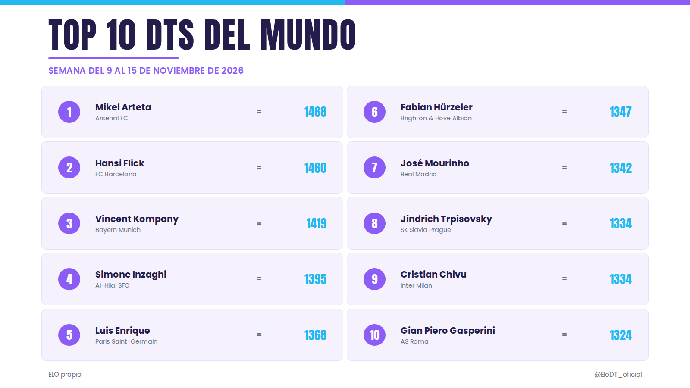
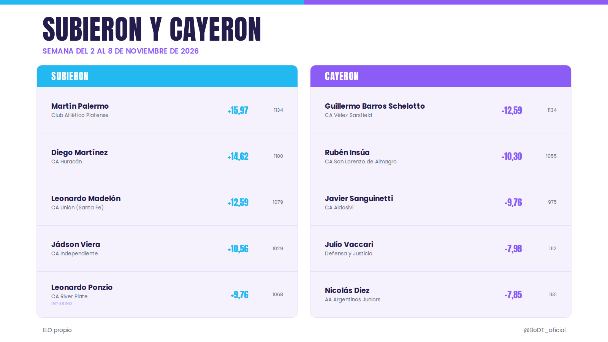
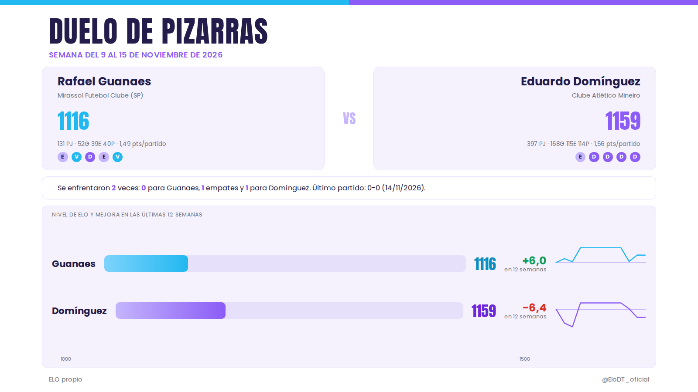

# ELO DT

Ranking ELO de directores técnicos de fútbol. Arrancan todos en 1.000 puntos y los mueven partido a partido, contra el técnico que tenían enfrente.

**215.674 partidos · 8.020 entrenadores · 76 competiciones · 2000 a hoy**



## Qué es

A los entrenadores se los suele juzgar por títulos o por sensaciones. Un ELO pone a todos en la misma cancha: cada partido transfiere puntos del técnico que pierde al que gana, en suma cero, y la posición en la tabla sale del historial completo y no de la última racha.

El proyecto toma partidos de ligas, copas y torneos de selecciones, identifica a los entrenadores de cada banco y reconstruye su rating desde cero. Sobre eso genera piezas listas para publicar: un Top 10 mundial, un Top 10 por país, las subidas y bajadas de la semana, un duelo entre dos técnicos y el ranking de los técnicos sin club.

## Cómo funciona el ELO

```
ΔELO = K · C · G · (R − E)
```

- **K** mide cuánto pesa el partido: 20 en liga regular, 30 en playoffs y fases finales, 40 en definiciones.
- **C** es el coeficiente de la competición. Una final de Libertadores no mueve lo mismo que una fecha de liga menor.
- **G** ajusta por el margen de gol. Una goleada pesa más que un 1-0, pero **menos si el ganador ya era muy favorito**. Un 4-0 del puntero contra el último no infla el rating.
- **E** es la expectativa según la diferencia de rating, con **45 puntos de ventaja de localía**.
- **R** es el resultado real: 1, 0,5 o 0.

Cada partido mueve el mismo total de puntos en las dos direcciones, así que **la masa del sistema se conserva**: con 8.020 entrenadores la suma siempre da 8.020.000. Eso se verifica en cada actualización.

Los parámetros están en `EloParams` (`elo.py`) y se adoptan sólo si mejoran la predicción medida. Ver [docs/MODELO_ELO.md](docs/MODELO_ELO.md).

## Las cifras

| | |
|---|---|
| Partidos cargados | 215.674 |
| Entrenadores | 8.020 |
| Competiciones | 76 (ligas, copas y selecciones) |
| Ventana histórica | 2000 a la fecha |
| Páginas de partido descargadas | ~277.000 |
| Entrenadores publicables hoy | 740 |
| Tests | 256 |

## Qué genera

Cada lunes el pipeline actualiza la base y arma el paquete de la semana en tres formatos (apaisado, vertical y cuadrado), más el texto y el texto alternativo de cada pieza.

**Subieron y cayeron**, el movimiento de la semana:



**Duelo de pizarras**, dos entrenadores cara a cara con su historial y la evolución de los últimos 12 meses:



Formatos disponibles: `top10.html`, `movers.html`, `duelo.html`, `revelacion.html`, `sin_club.html` y `gta.html`. El render falla si el contenido no entra en el lienzo, así que nunca sale una imagen cortada.

## El trabajo estuvo en los datos

El modelo son treinta líneas de matemática. Lo demás fue conseguir datos confiables:

- **Bloqueos.** El portal responde con un desafío JavaScript anti-bot a las IP de datacenter. Se resuelve con un Chromium headless que obtiene la cookie de sesión y la inyecta en la sesión HTTP. Además el ritmo está limitado a ~14 pedidos por minuto entre tres procesos: por encima de eso la IP queda bloqueada por días.
- **Fechas corridas.** La fecha del fixture no es confiable: la página la imprime una sola vez por bloque y el bloque puede abarcar varias jornadas. La fecha real está en la página del partido. Se recuperaron 187 fechas mal cargadas.
- **Páginas viejas.** El layout anterior de los reportes no traía la tabla de suplentes, y el parser descartaba partidos con entrenador presente en la página. Corregido: se recuperaron 7.720 partidos de 2012 a 2026.
- **Atribución de clubes.** Los clubes sudamericanos nacían con país "Conmebol" porque se tomaba el país de la competencia. Se corrige con la liga doméstica donde más juegan.
- **Cobertura.** Una auditoría compara los fixtures descargados contra los cargados, por competencia y por año, y detecta huecos reales.

Todo esto queda cubierto por una regla simple: **si la validación falla, no se publica nada.** El validador corre en cada actualización y exige cero partidos duplicados, suma cero por partido y la masa de ELO conservada.

## Qué se publica y qué no

`publicacion.py` es la única fuente de verdad. Un entrenador entra en el ranking si dirige hoy un club, tiene al menos 15 partidos (5 si es interino), dirigió en el último año y la liga de su club tiene cobertura de al menos 90 % en los últimos tres años, medida por país. Entre 15 y 29 partidos queda marcado como provisorio. Un técnico de selección no compite en el ranking de clubes y no cuenta como "sin trabajo".

Hoy: 740 publicables, 69 provisorios, 71 interinos y 455 sin club.

## El modelo no se eligió a ojo

`backtest.py` reproduce el histórico en memoria (203.000 partidos en unos 2 segundos) y mide Brier del resultado, log-loss 1X2 y calibración por tramos de expectativa. Con eso se probó cada cambio de parámetro, entrenando con 2016-2022 y validando con 2023-2026.

La línea base daba Brier 0,1638 en los partidos donde ambos técnicos tenían 30 partidos o más. La ventaja de localía en 45 y el margen de gol amortiguado la bajan a 0,1616. Es una mejora chica, pero está medida sobre datos que el modelo no vio. La calibración de técnicos nuevos se implementó, no mejoró la predicción y quedó apagada.

## Arquitectura

```
scraping/          cliente HTTP, resolución del desafío, parser, caché en disco
  client.py        reintentos, backoff, ritmo, sesión con huella de Chrome
  waf.py           resuelve el desafío JS con Chromium headless
  parser.py        HTML -> DTO (fixture, reporte, fecha real, entrenadores)
  storage.py       caché atómica por competencia y temporada
  pipeline.py      scrape, normaliza y persiste

models.py          ORM (SQLAlchemy 2.0). Fuente de verdad del esquema
migrations/        SQL plano, idempotente, se aplica con migrate.py
elo.py             matemática pura del ELO, sin base de datos
backtest.py        replay del histórico y métricas de calibración
services.py        orquestación: carga idempotente y recálculo determinista
publicacion.py     reglas de qué se publica
content.py         datos de cada pieza (Top 10, movers, duelo, revelación)
render_html.py     Jinja2 + Chromium, tres variantes por plantilla
captions.py        texto y alt de cada pieza
notify.py          entrega por Telegram
scripts/           CLIs: weekly_run, audit_data, validate_elo, backtest_elo, ...
```

El flujo semanal:

```
update  -> scraping incremental, correcciones, recálculo, validación, snapshot
render  -> PNG en tres formatos + texto + alt
notify  -> Telegram, un bloque por pieza
```

Lo dispara n8n en Windows, con el Programador de tareas como respaldo idempotente. Si la validación de invariantes falla, el pipeline sale con código 20 y no genera el paquete.

## Cómo correrlo

Requiere Python 3.12 y PostgreSQL. Los tests no necesitan base de datos: usan SQLite en memoria.

```bash
cp .env.example .env          # completar DB_HOST, DB_PORT, DB_NAME, DB_USER, DB_PASS
pip install -r requirements.txt
python migrate.py --create-db

# una competencia, punta a punta
python scraper_transfermarkt.py list
python scraper_transfermarkt.py scrape --competition GB1 --season 2024
python scraper_transfermarkt.py load   --competition GB1 --season 2024

# recálculo y validación
python scraper_transfermarkt.py recompute
python scripts/validate_elo.py --min-partidos 20 --top 12

# paquete de la semana
python scripts/weekly_run.py render

# tests
python3 -m pytest
```

Para scraping hace falta además `playwright install chromium`. Se puede desactivar el resolver con `TM_WAF_SOLVER=false`.

Otros comandos: `scripts/audit_data.py` (cobertura y conflictos de fecha), `scripts/backtest_elo.py` y `scripts/tune_elo.py` (modelo), `scripts/publicables.py` (quién entra y por qué no), `scripts/weekly_run.py selecciones` (fecha FIFA), `sin_club` (técnicos libres) y `gta` (comparativo bajo demanda).

## Tests

256 tests, sin base de datos. Cubren la matemática del ELO (suma cero, conservación de masa, calibración), el parser, la alineación de temporadas, las reglas de publicación, las capas de contenido y las plantillas.

```bash
python3 -m pytest
```

## Datos

Los partidos se descargan de [Transfermarkt](https://www.transfermarkt.com/). El repositorio no redistribuye la caché: vive en `data/`, que está fuera del control de versiones, y hay que reconstruirla con los comandos de arriba.

## Licencia

MIT. Ver [LICENSE](LICENSE).